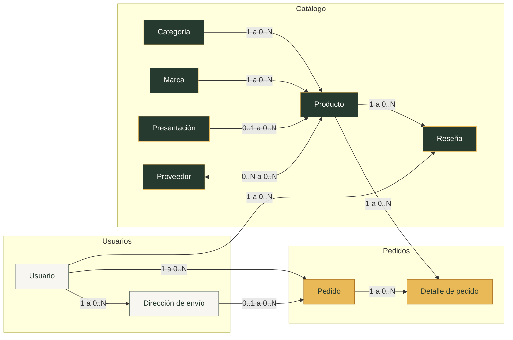
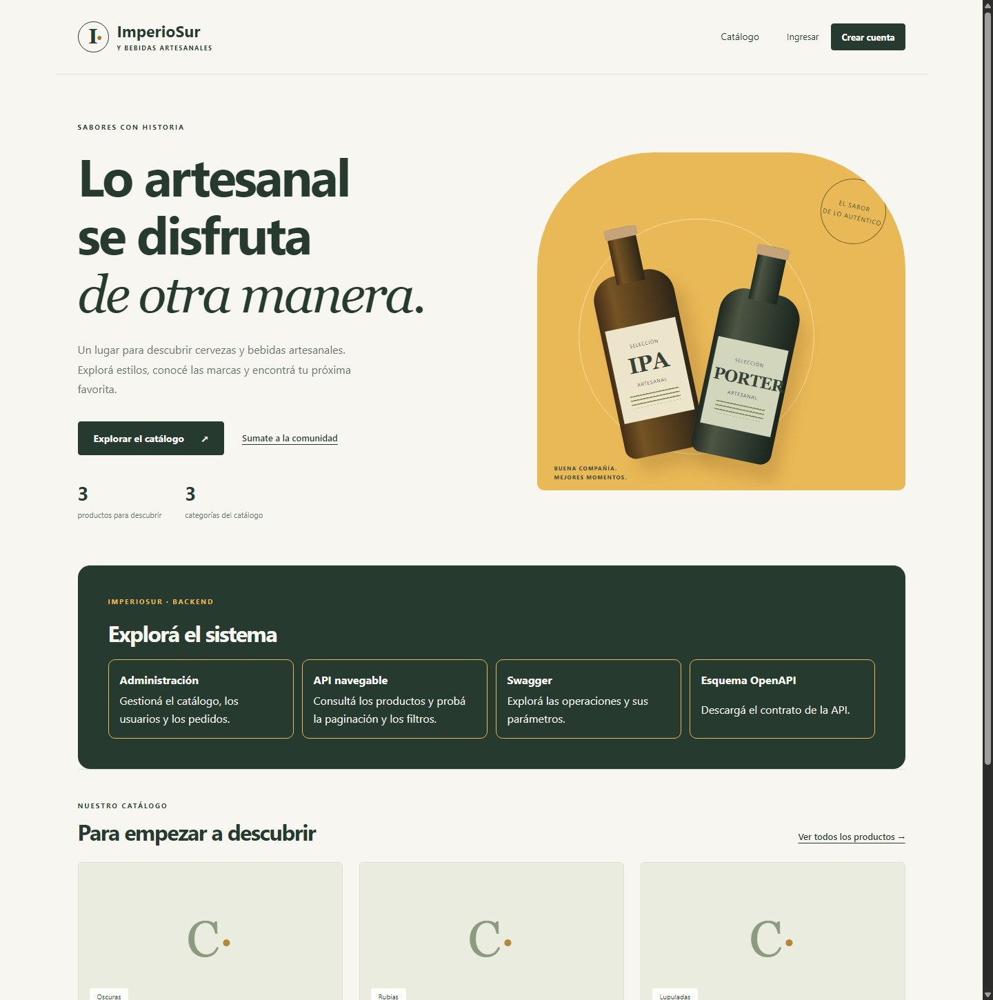
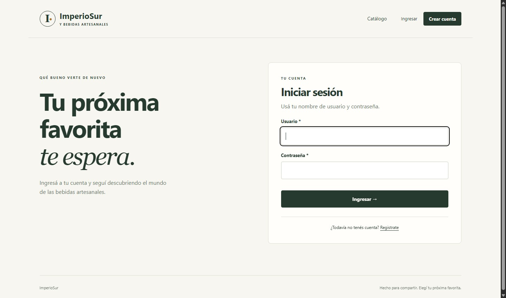

# ImperioSur — Backend de Ingeniería de Software

Sistema de gestión de catálogo, clientes y pedidos de una cervecería y tienda de bebidas artesanales. Backend de la EFI 2026 de Ingeniería de Software, conectado al frontend ImperioSur de Programación III mediante la API de catálogo.

## Integración con el frontend

El frontend de Programación III consume la API de este backend. El contrato y los datos de prueba se detallan en [docs/integracion-frontend.md](docs/integracion-frontend.md).

## Integrantes

- Benjamín De Lauro
- Ignacio Piñeiro
- Esteban Rodríguez

## Tecnologías

Python, Django, Django REST Framework, SQLite y uv. Las dependencias se fijan en `uv.lock`.

## Planificación de la base de datos

La consigna vigente requiere al menos **10 modelos propios relacionados**. A los seis modelos iniciales se suman Presentacion, Proveedor, DireccionEnvio y Resena. La planificación de campos, relaciones y reglas se encuentra en [docs/modelos.md](docs/modelos.md).



Cada conexión indica cuántos registros pueden relacionarse. Por ejemplo, un pedido tiene una dirección opcional (`0..1`) y puede incluir varios detalles (`0..N`).

## Ejecución local

Se necesita Python 3.12 o superior y [uv](https://docs.astral.sh/uv/).

```shell
uv sync --locked
uv run python manage.py migrate
uv run python manage.py configurar_grupos
uv run python manage.py cargar_catalogo_demo
uv run python manage.py createsuperuser
uv run python manage.py runserver
```

La bienvenida está disponible en `http://127.0.0.1:8000/` y el administrador en `http://127.0.0.1:8000/admin/`. La base SQLite, los usuarios locales, las imágenes y `.venv` no se suben a Git.

## Ejecución con Docker

Con Docker iniciado y Compose v2, desde la raíz del repositorio:

```powershell
Copy-Item .env.example .env
docker compose up --build -d --wait
docker compose exec web python manage.py createsuperuser
```

En Linux/macOS usar `cp .env.example .env` en el primer paso. El ejemplo se copia
solo la primera vez. Las migraciones y los grupos se preparan al iniciar el
servidor. SQLite y las imágenes se conservan en volúmenes separados. La aplicación
queda disponible en `http://127.0.0.1:8000/`.

Los comandos de pruebas, variables, persistencia y conexión con el frontend se
explican en [docs/docker.md](docs/docker.md). El workflow **Verificar Docker**
construye y prueba el contenedor en GitHub Actions.

## Usuarios, pantallas y permisos

- Registro: `/usuarios/registro/`. Crea una cuenta del grupo **Clientes** y abre su sesión.
- Login: `/usuarios/login/`. Logout mediante POST: `/usuarios/logout/`.
- Catálogo público con búsqueda y paginación: `/catalogo/productos/`.
- Altas, edición y eliminación de productos y categorías mediante templates, protegidas con los permisos de Django.
- Grupo **Gestores de catálogo** configurado mediante `configurar_grupos`. Un administrador puede asignarlo desde Usuarios. El comando se puede repetir y no convierte a sus miembros en personal ni superusuarios.
- Context processor propio, mensajes de confirmación, CSRF y pantallas adaptables a dispositivos móviles.
- API de autenticación por token: `/api/auth/login/`, `/api/auth/me/` y `/api/auth/logout/`. También se habilitan las sesiones y el acceso navegable en `/api-auth/login/`.

Los pasos de prueba, la matriz de permisos y el contrato para integrar la API se detallan en [docs/autenticacion.md](docs/autenticacion.md).

### Rutas para probar el backend

Una vez iniciado el servidor en el puerto 8000, podés abrir estas páginas en tu equipo.

| Página | Abrir |
| --- | --- |
| Bienvenida y accesos | [`/`](http://127.0.0.1:8000/) |
| Catálogo web | [`/catalogo/productos/`](http://127.0.0.1:8000/catalogo/productos/) |
| Administración de Django | [`/admin/`](http://127.0.0.1:8000/admin/) |
| API navegable de productos | [`/api/productos/`](http://127.0.0.1:8000/api/productos/) |
| Swagger | [`/api/docs/`](http://127.0.0.1:8000/api/docs/) |
| Esquema OpenAPI | [`/api/schema/`](http://127.0.0.1:8000/api/schema/) |
| Inicio de sesión | [`/usuarios/login/`](http://127.0.0.1:8000/usuarios/login/) |

### Capturas de funcionamiento

Bienvenida del backend:



Inicio de sesión:



## Verificación

```shell
uv run python manage.py check
uv run python manage.py makemigrations --check --dry-run
uv run python manage.py test
```

## Entrega y trabajo en curso

Esta versión reúne los aportes de modelos, administración, autenticación, API REST y Docker. La API navegable está disponible en `/api/productos/`, Swagger en `/api/docs/` y el esquema OpenAPI en `/api/schema/`.

La API registra ocho ViewSets: productos, categorías, marcas, presentaciones, proveedores, direcciones, pedidos y detalles de pedido. Los listados de productos y pedidos incluyen relaciones anidadas. Las acciones de pedidos permiten consultar el total y cancelar un pedido pendiente.

Seguimos trabajando en los detalles de la consigna y en la verificación con el frontend. Los cambios posteriores se preparan en ramas de trabajo y se revisan antes de integrarlos a `main`.
